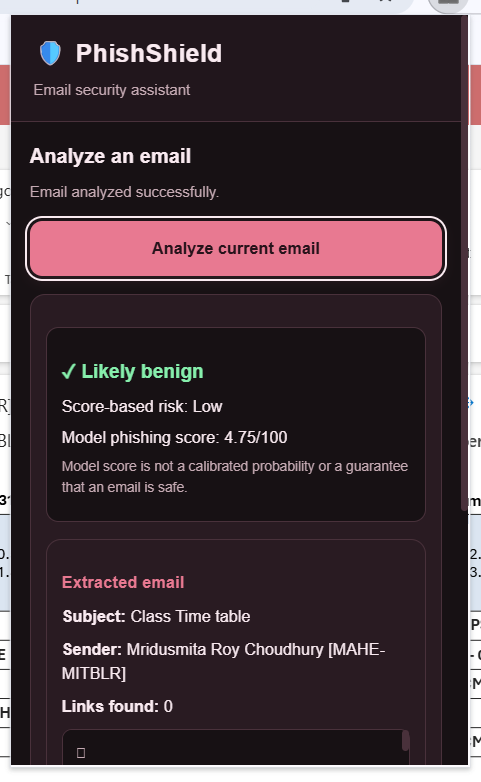
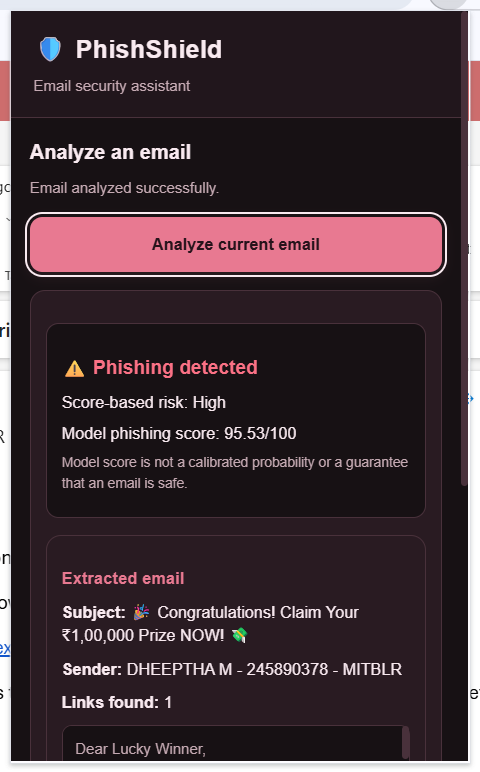

# 🛡️ PhishShield — AI-Powered Phishing Email Detection

PhishShield is a Chrome extension that helps identify potentially malicious emails in **Gmail and Outlook on the web** using machine learning and rule-based analysis. It analyzes email content and highlights suspicious messages to help users make safer decisions.

## ✨ Features

- **Browser extension:** Designed to work with Gmail and Outlook on the web in Chrome.
- **Machine learning detection:** Uses a trained classification model to assess email content.
- **Rule-based analysis:** Checks for suspicious language, urgency, fake prizes, account-security threats, and potentially suspicious links or attachments.
- **Risk assessment:** Combines detection results to help users recognize potentially suspicious emails.
- **Local API:** Uses a FastAPI backend to process email analysis requests.
- **Privacy-conscious architecture:** Designed to analyze emails through a locally running backend during development.

## 🧰 Tech Stack

- Python
- Machine Learning and scikit-learn
- FastAPI
- JavaScript, HTML, and CSS
- Chrome Extension APIs
- Joblib
- Gmail and Outlook on the web

## 🏗️ Architecture

PhishShield uses a Chrome extension and a local FastAPI backend to analyze email content.

1. **Email extraction (`content.js`):** Runs on supported Gmail and Outlook web pages to extract relevant email information.
2. **Popup interface (`popup/`):** Provides the PhishShield interface through `popup.html`, `popup.js`, and `popup.css`.
3. **Backend API (`backend/app.py`):** Receives analysis requests through FastAPI and loads the trained model from `backend/phishshield_model.pkl`.
4. **Machine learning prediction:** The trained model classifies email content, while rule-based checks look for suspicious language and indicators.
5. **Results:** The extension presents the assessment to help users recognize potentially suspicious messages.

### Supported webmail domains

- Gmail: `mail.google.com`
- Outlook on the web: `outlook.office.com`
- Outlook.com: `outlook.live.com`
- Microsoft Outlook web: `outlook.cloud.microsoft`

During local development, the extension connects to the backend at `http://127.0.0.1:8000`. Keep the backend running while testing the extension.

## 📸 Screenshots

### Benign email detection



### Phishing email detection



## 📊 Model Evaluation

The project's reported training and evaluation run used **103,512 usable emails**.

| Metric | Result |
|---|---:|
| Usable emails in dataset | 103,512 |
| Benign emails | 57,122 |
| Phishing emails | 46,390 |
| Test accuracy | 97.85% |

The reported confusion matrix was:

| Actual / Predicted | Benign | Phishing |
|---|---:|---:|
| Benign | 11,186 | 239 |
| Phishing | 207 | 9,071 |

These results are from the project's reported evaluation run. Actual performance on new emails may differ. Model scores are not calibrated probabilities and should not be treated as a guarantee that an email is safe or malicious.

## 🚀 Getting Started

### Prerequisites

- Google Chrome
- Python 3.10 or a compatible version for the dependencies
- Git

### 1. Clone the repository

```bash
git clone https://github.com/dheeptha07/PhishShield.git
cd PhishShield
```

### 2. Set up the backend environment

Create and activate a virtual environment from the repository root.

**Windows PowerShell:**

```powershell
python -m venv .venv
.\.venv\Scripts\Activate.ps1
```

Install the backend dependencies:

```bash
pip install -r backend/requirements.txt
```

### 3. Start the FastAPI backend

From the repository root, run:

```bash
uvicorn backend.app:app --reload --host 127.0.0.1 --port 8000
```

If the command cannot import `backend.app`, change into the backend folder and run:

```bash
cd backend
uvicorn app:app --reload --host 127.0.0.1 --port 8000
```

The API should be available at `http://127.0.0.1:8000`. Interactive API documentation is available at `http://127.0.0.1:8000/docs`.

The trained model file, `backend/phishshield_model.pkl`, must be present for the backend to start successfully.

Keep the backend terminal running while testing the extension.

### 4. Load the Chrome extension

1. Open `chrome://extensions` in Chrome.
2. Enable **Developer mode**.
3. Click **Load unpacked**.
4. Select the PhishShield project folder containing `manifest.json`.
5. Open Gmail or Outlook on the web in Chrome.
6. Open an email, click the PhishShield extension icon, and select **Analyze current email**.

The extension's configured API URL must match the local backend address.

## 🧪 Testing

Test the extension with a variety of examples:

- A legitimate email with ordinary language.
- An email containing urgent account-verification requests.
- A fake prize or payment message.
- An email with suspicious links or attachment language.

Compare the displayed assessment with the known test case. Detection is probabilistic, so legitimate emails can be flagged and phishing emails can be missed.

## 🔒 Security and Limitations

- Keep API keys, credentials, private email content, and local environment files out of the public repository.
- The development backend is configured for local use. A public deployment would require appropriate authentication, access controls, and secure transport.
- The current development CORS configuration allows requests from any origin. Restrict allowed origins before deploying the backend publicly.
- Machine learning and keyword rules can produce false positives and false negatives.
- This project is an assistive security tool, not a replacement for careful verification of email senders, URLs, and requests for sensitive information.

## 🔮 Future Improvements

- Improve extraction consistency across Gmail and Outlook on the web.
- Add clearer explanations for risk indicators.
- Expand evaluation to independent, unseen email datasets.
- Improve automated testing and error handling.
- Add privacy and security controls for any future hosted deployment.

## 👩‍💻 Author

**Dheeptha M.**

- GitHub: [@dheeptha07](https://github.com/dheeptha07)

*PhishShield is an educational project exploring machine learning and browser-based phishing detection.*
